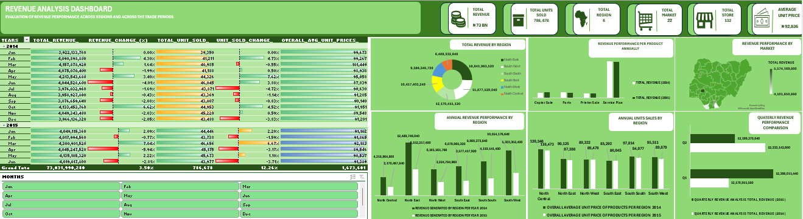

# Revenue_Analysis
<h3 align="center">📊 Featured Data Analytics Project</h3>

  

This analysis examines the organization's annual revenue trend and evaluates revenue performance across regions, providing insights into overall business performance and identifying the regions that contribute most to revenue generation.  

# Project Objectives 
- Exploring the annual revenue trends
- Understanding regional performance
- Making quarterly comparisons of revenues
- Analyzing line of business contributions to revenue growth or decline  
# Data Source 
The dataset was primarily obtained from Kaggle.
#  Tools Used 
- Power Query
- Microsoft Excel
# Data Cleaning 
After the dataset was collected, it was imported into Power Query for data cleaning and validation. Comprehensive quality checks were performed to identify duplicates, missing values, misspellings, and inconsistencies, while also assessing data uniqueness, distribution, and overall data quality to ensure the dataset was accurate and ready for analysis.
The data set was then exported into microsoft excel for further analysis. 
# Exploratory Data Analysis 
An exploratory data analysis (EDA) was conducted to understand the dataset and uncover key patterns before building the dashboard. The analysis focused on examining revenue and units sold across regions, markets, line of business, and time periods (years, months, and quarters).
# Key Insight 
2014
1. Between February and March 2014, revenue increased from 4,090,898,880 to 4,157,878,920 (+1.64%). Although units sold declined slightly from 41,211 to 40,985, the average selling price increased from 99,267 to 101,449. This indicates that the revenue increase was primarily driven by higher pricing rather than sales volume.
2. The most significant revenue decline in 2014 occurred between May and June, with revenue falling from 4,213,543,680 (+3.40%) to 4,044,528,600 (-4.01%). Interestingly, units sold increased from 44,326 to 46,045, while the average selling price dropped sharply from 95,058 to 87,839. This indicates that the reduction in price did increase frequency in  sales volume, but still resulted in lower revenue.
3. The strongest revenue recovery in 2014 occurred between September and October, where revenue increased from 3,876,659,640 (-2.08%) to 4,133,453,760 (+6.62%). During the same period, units sold increased from 43,007 to 44,953, while the average selling price rose from 90,140 to 91,951. The revenue growth was supported by improvements in both sales volume and pricing.
4. A reduction in average selling price appears to encourage higher sales volume; however, increased volume does not always translate into higher revenue. For example, between October and November 2014, the average selling price declined from 91,951 to 89,548, while units sold increased slightly from 44,953 to 45,220. Despite the increase in units sold, revenue fell from 4,133,453,760 (+6.62%) to 4,049,343,480 (-2.03%). This suggests that the impact of lower pricing was greater than the benefit gained from additional unit sales.

2015
1. The largest revenue decline across both years occurred between March and April 2015, with revenue dropping from 4,300,901,520 to 4,045,247,520 (-5.94%). This decline coincided with a decrease in units sold from 46,656 to 45,175 and a reduction in average selling price from approximately 92,183 to 89,546. The drop in revenue was driven by declines in both sales volume and pricing.
2. Prior to this decline, revenue reached its highest level in March 2015, increasing from 4,017,994,560 to 4,300,901,520 (+7.04%). During the same period, units sold increased significantly from 43,738 to 46,656, while the average selling price rose slightly from 91,865 to 92,183. This suggests that strong revenue growth was largely driven by increased sales volume, with pricing providing additional support.  

# Recommendations 
**Optimization of Pricing pattern to protect revenue** 
- Review and refine the organization's pricing strategy to avoid excessive price reductions as a primary means of driving sales. The analysis indicates that while lower prices often increased sales volume, they did not consistently result in higher revenue. A balanced pricing approach should be adopted to maximize both profitability and revenue growth. 
**Revenue Growth strategy dependency**
 - Focus on identifying and replicating the business strategies that successfully improved both sales volume and revenue. The analysis shows that the strongest revenue performance occurred when increases in sales volume were supported by stable or higher average selling prices. Future growth initiatives should therefore prioritize sustainable revenue generation over volume growth alone.  
# Conclusion 
The analysis identified key patterns associated with revenue, including its growth and decline over time. While a more extensive analysis of revenue performance by line of business, region, and market is provided in the accompanying Excel workbook, the key findings highlight that upward revenue growth and increased unit sales are driven primarily by a reasonably high or stable average price per unit sold, rather than a dependency on excessive reductions in average selling prices.

